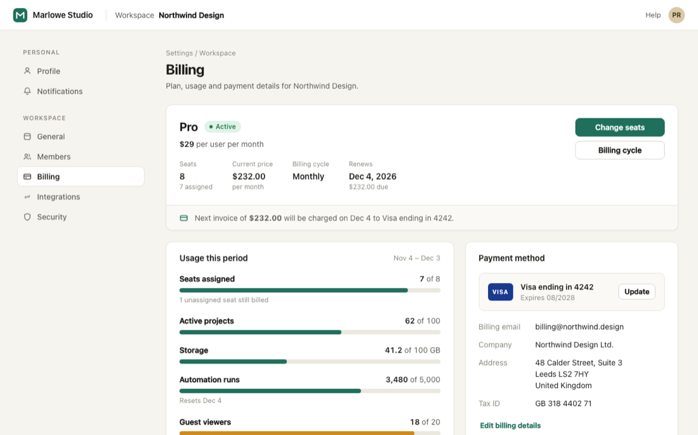
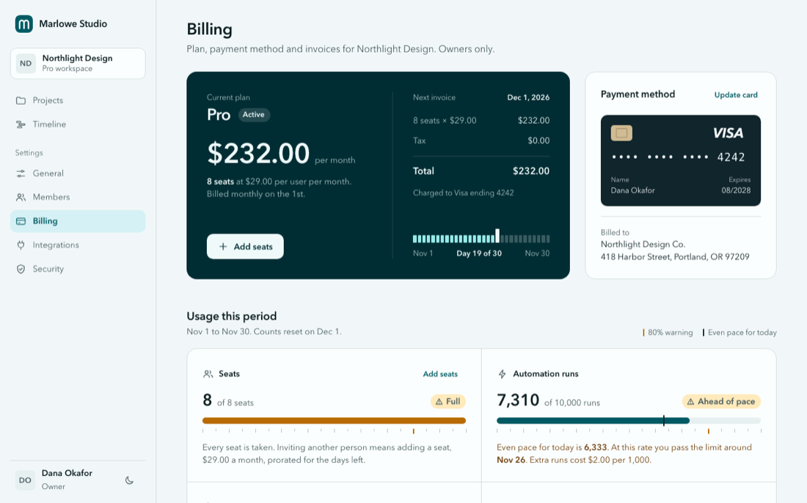
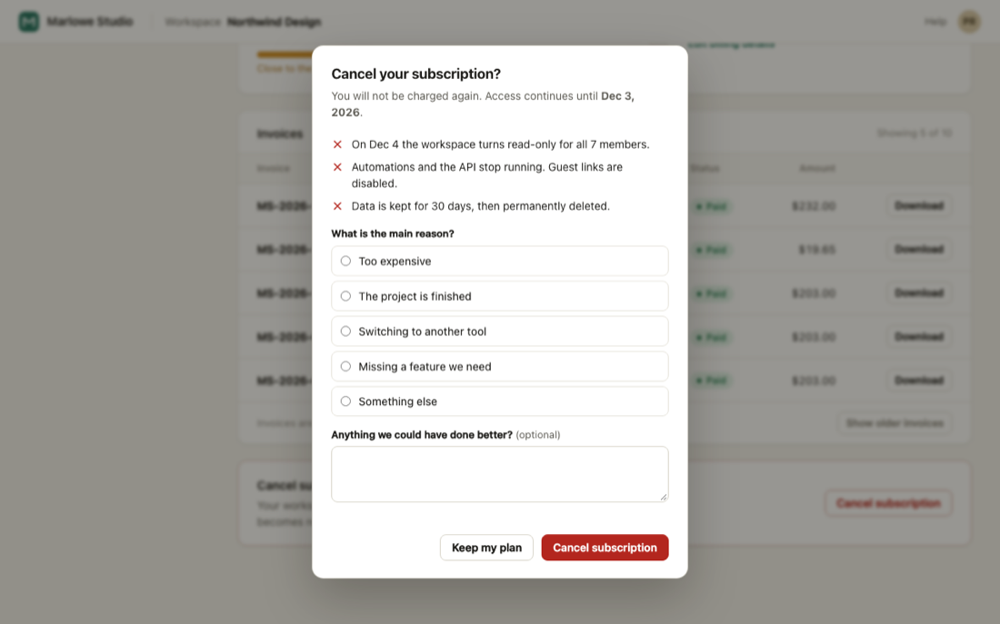
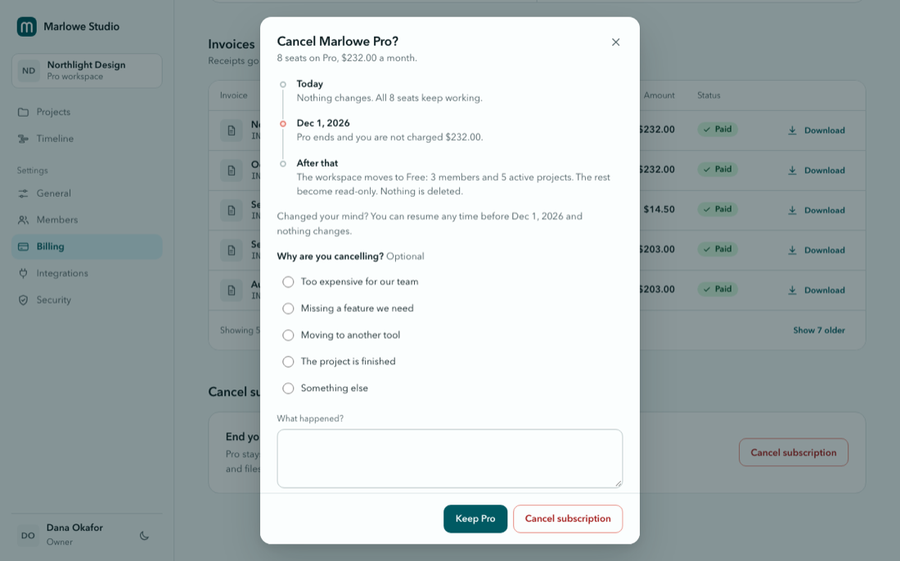
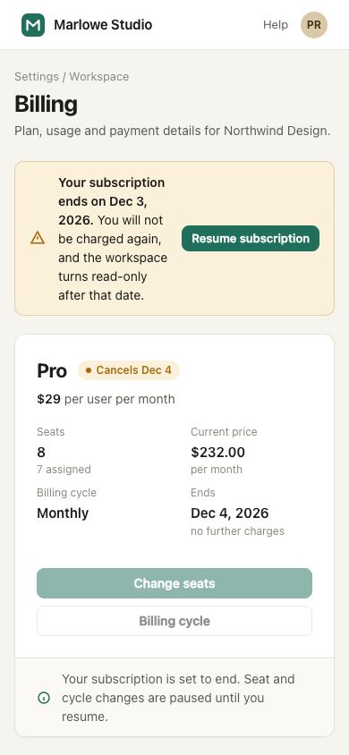
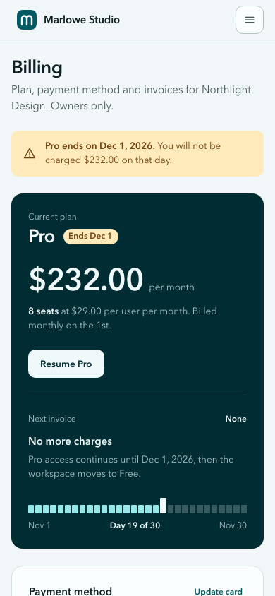
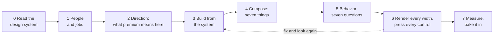

# interface-limb

[](.claude-plugin/plugin.json)
[](LICENSE)
[](https://claude.com/claude-code)
[](https://github.com/MubiZero/interface-limb/actions/workflows/check.yml)

**A system-first design skill for Claude Code. It makes AI-built UI stop looking and behaving vibe-coded.**

Before it draws a screen, it finds the product's design system (tokens, components, one shared surface per job, one
grammar of gestures and feedback). Then it builds only from that system, renders the result at every width, presses
every control, and judges both how the screen looks and how it behaves. Every number in it traces to a cited standard
(WCAG 2.2, Material, Apple HIG, NN/g, Core Web Vitals), not to taste.

You do not have to say "design". *"Build the login screen"*, *"why does this look AI-made"*, *"unify these dialogs"*,
*"is this ready to ship"* are enough to trigger it. Works with React/Tailwind/CSS, Angular/PrimeNG, Flutter and
React Native.

## What it produces

One task, given word for word to two Sonnet agents: *a billing settings page for "Marlowe Studio": current plan (Pro,
$29 per user per month, 8 seats), usage, payment method, invoices, a way to cancel; one self-contained HTML file.*
The first agent had no skills and no guidance. The second read this skill and followed it. Screenshots taken the same
way for both, pressing the same controls.

| | Without the skill | With the skill |
|---|---|---|
| **First screen** |  |  |
| **After pressing "Cancel subscription"** |  |  |
| **Phone, 390 px** |  |  |

What to read from it:

- A plain Sonnet already makes a clean, competent page, with its own green brand, icons and a working cancel dialog.
  The skill's first version of this run was *not* better on the first screen (generic blue, a black square for a
  logo, a dead corner in the plan card); that comparison is what produced the direction card and the pro bar in  version 3.2.
- With the skill the screen has a point of view: a hero plan card with the decisive number, a real card face, an icon
  language, usage bars with a warning mark and a "you pass the limit around Nov 26" pace marker, and a dark theme.
- The behavior is where it pulls away: a cancel dialog that shows a timeline of what changes and when, an *Undo* in the
  toast, a banner and a *Resume* button in place, the plan card turning into a "no more charges" state, a menu button on
  the phone where the plain version has no way to reach the other pages, and no invented policy ("data deleted after
  30 days") that the product never promised.
- The cost is real: this run took about 8.5 minutes and 34 tool calls, against about 2.7 minutes and 6 for the plain
  answer. It is one run per side, not a benchmark; rerun it yourself.

Open the two files side by side: [`demos/C_billing/without.html`](demos/C_billing/without.html) and
[`demos/C_billing/with.html`](demos/C_billing/with.html) (desktop width), or the older pairs
[`compare_A_pricing.html`](demos/compare_A_pricing.html) and [`compare_B_empty.html`](demos/compare_B_empty.html).

## Install

```
/plugin marketplace add MubiZero/interface-limb
/plugin install interface-limb@mubizero-skills
```

or from the shell:

```bash
claude plugin marketplace add MubiZero/interface-limb
claude plugin install interface-limb@mubizero-skills
```

Update later with `claude plugin update interface-limb@mubizero-skills`, then restart Claude Code.

No plugin system? Copy the folder: `cp -r skills/interface-limb ~/.claude/skills/interface-limb`.

## Why system first

AI-built UI fails the same way everywhere. Every component is built from scratch, the model picks its own colors,
every element gets the same weight, the content is placeholder, the same job (confirm, pick one, type a number) gets a
new dialog each time, and nobody looks at the rendered result. It also *behaves* vibe-coded: buttons that do nothing
or only pretend (a toast where a process should be), things that pile up with no way to remove them, an «Undo» on a
payment. Polishing screens one by one does not fix that. The skill works on the layers that do.



- **The seven things** every good screen has: one focal point, spacing that groups, hierarchy from weight and color,
  one accent, real content, matching details, repeated elements measured on the data.
- **The seven questions** about behavior: does every control act, does every action have its way back, one gesture
  grammar, consequences visible before the commit, one pattern per kind of message, scroll and focus follow the
  action, motion from one module.
- **A floor that is part of the craft:** contrast 4.5:1, targets 44 pt / 48 dp / 24 px, visible focus, a single-tap
  alternative to every gesture, reduced motion honored live, text to 200 %.
- **Reviews that triage:** findings rated 0-4 by severity, a cut list, orientation and grayscale/blur tests, and a
  blunt ship / not-done verdict for "is it ready".

## Where to start, by symptom

| The complaint | Start with |
|---|---|
| Users get lost, abandon forms | [critique](skills/interface-limb/references/critique.md), [discovery](skills/interface-limb/references/discovery.md), [input](skills/interface-limb/references/input.md) |
| Looks flat or AI-made | [review-by-eye](skills/interface-limb/references/review-by-eye.md), [visual](skills/interface-limb/references/visual.md), [anti-slop](skills/interface-limb/references/anti-slop.md) |
| Nothing acknowledges the tap | [states](skills/interface-limb/references/states.md), [motion](skills/interface-limb/references/motion.md) |
| Too many dialogs, screens disagree | [design-system](skills/interface-limb/references/design-system.md), [patterns](skills/interface-limb/references/patterns.md) |
| Feels off on iPhone or Android | [mobile](skills/interface-limb/references/mobile.md) |
| A page that must convince a stranger | [marketing-landing](skills/interface-limb/references/marketing-landing.md) |
| A week before launch | [critique: release gate review](skills/interface-limb/references/critique.md) |

The full map, with when to read each of the 27 reference files, is the table in
[`SKILL.md`](skills/interface-limb/SKILL.md). References load only when the task needs them.

## Tools it ships

| Script | What it does |
|---|---|
| [`scripts/ds_audit.sh <src>`](skills/interface-limb/scripts/ds_audit.sh) | Counts literal colors, sizes, durations and one-off dialogs against tokens; reads as a symptom map of design-system drift |
| [`scripts/shoot_widths.sh`](skills/interface-limb/scripts/shoot_widths.sh) | Renders a page at desktop, tablet and phone widths (phones through iframes, as headless Chrome will not go below ~500 px) |
| [`scripts/dead_buttons.js`](skills/interface-limb/scripts/dead_buttons.js) | Presses every visible control and reports `ok`, `SELF` (only itself changed) or `DEAD` |
| [`scripts/run_evals.sh`](skills/interface-limb/scripts/run_evals.sh) | Runs the eval prompts through Claude Code without and with the skill and saves both answers for comparison |
| [`scripts/check.sh`](skills/interface-limb/scripts/check.sh) | Repo self-check: manifest versions, frontmatter, links, reference map, evals, script syntax |

## Test it

```bash
bash skills/interface-limb/scripts/run_evals.sh --list            # 10 evals: build, review, mock, mobile, gestures, release gate
bash skills/interface-limb/scripts/run_evals.sh --only 7 --dry-run
bash skills/interface-limb/scripts/run_evals.sh --only 7          # runs it twice, with and without the skill
```

The evals in [`evals/evals.json`](skills/interface-limb/evals/evals.json) have an `expected_output` each; read the
`*.with.md` answer against it. Two fixtures (a plain React settings card and a plain Flutter login) sit in
`evals/files/`, and `ds_audit.sh` runs on them as part of the self-check.

## Development

```bash
bash skills/interface-limb/scripts/check.sh   # must print ALL OK
node demos/build_compare.mjs                  # rebuild the compare pages after editing a demo
```

CI runs both on every push. To release: change `version` in `.claude-plugin/plugin.json` and
`.claude-plugin/marketplace.json` together (and the badge above), run the check, push.

```
.claude-plugin/        plugin and marketplace manifests
skills/interface-limb/
  SKILL.md             the workflow, the symptom table, the review format
  references/          27 files, read on demand
  scripts/             the five tools above
  evals/               prompts, expected outputs, fixtures
demos/                 three with/without pages and the page builder
assets/                the comparison screenshots above
```

## Built on

Developed with the `skill-creator` loop: draft, run real prompts with and without the skill, compare, tighten. Lessons
baked in: verify the *computed* gap, not the declaration (a more specific CSS reset silently zeroing an intended
margin is the most common way whitespace vanishes). Sources: WCAG 2.2, Material Design 3, Apple HIG, Nielsen Norman
Group, Vercel Web Interface Guidelines, Core Web Vitals; the review heuristics follow Nielsen, Krug, Norman and Saffer.

## License

[MIT](LICENSE) © 2026 MubiZero
