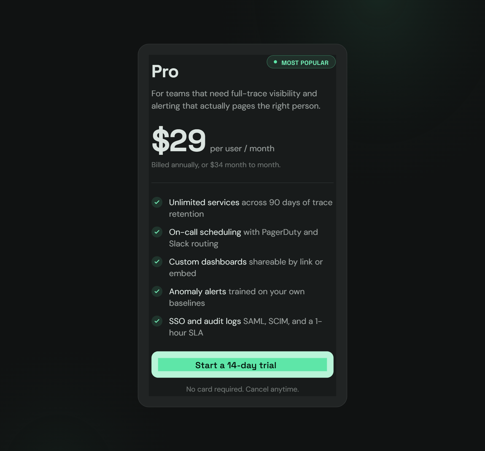
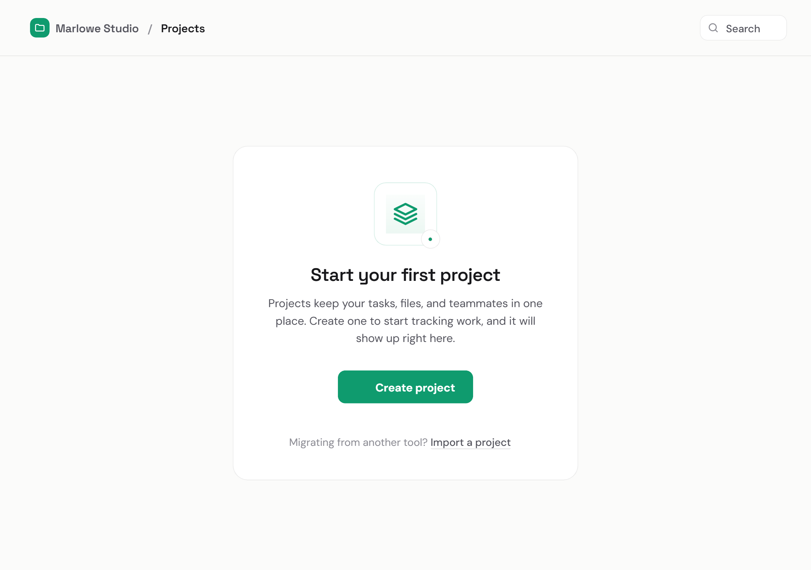

# interface-limb

A design-sense layer for [Claude Code](https://claude.com/claude-code) skills. It turns generic,
"developer-default" UI into interfaces that feel considered, and it backs every decision with a
cited standard instead of taste alone.

Reach for it on any frontend work, building a screen from scratch or elevating one that already
exists. You do not have to say "design": prompts like *"build the login screen"*, *"make a
dashboard"*, or *"improve how this looks"* are enough to trigger it.

## What it produces

Two screens, each built by Claude with the skill active. Same models, same frameworks, the
difference is entirely in the handling of hierarchy, spacing, states, and the quiet details.

### A pricing card



Dark theme done properly: a near-`#121212` base (not pure black), depth from *lightening* surfaces
rather than heavy shadow, a single committed accent, text at tiered opacity, and a CTA with real
hover, focus-ring, and pressed states.

### An empty state



The moment most products skip. A positive title ("Start your first project", not "No projects"),
a single direct action, and a quiet secondary path kept at a comfortable distance from the primary
button. The breadcrumb and search control actually respond, they are not dead decoration.

> **See them live (and compare against the default output):**
> [pricing](https://mubizero.github.io/interface-limb/demos/compare_A_pricing.html) ·
> [empty state](https://mubizero.github.io/interface-limb/demos/compare_B_empty.html)

## Why a skill, not a prompt

Great app UI does not come from technical complexity. It comes from dozens of small, non-obvious
decisions applied consistently. The skill makes those decisions explicit and grounds them in
concrete values rather than vibes:

- **Accessibility floor as craft:** contrast `≥ 4.5:1`, touch targets `≥ 44pt / 48dp / 24px`,
  a visible keyboard focus indicator on everything focusable.
- **Six interaction microstates** on every interactive element, including the structural controls
  (breadcrumbs, nav, tabs, icon buttons, search, list rows) where "dead UI" usually hides.
- **Dark theme as its own discipline,** not an inverted light theme.
- **Motion that confirms, never performs:** durations by scale, exits faster than entrances, only
  `transform` and `opacity` animated, reduced-motion respected.
- **An anti-slop pass** that bans the tells of machine-generated UI (default Inter plus purple glow,
  nested cards, fake div-built product shots, em-dashes in copy).

Cited throughout: WCAG, Material Design 3, Apple HIG, NN/g, and the Vercel Web Interface Guidelines.

## What is inside

```
skill/                  the skill itself
  SKILL.md              the principles, the flow (direction -> build -> pre-flight)
  references/           progressive-disclosure detail
    direction.md        pick a deliberate aesthetic instead of the default
    web.md              React / Tailwind / CSS tokens
    angular-primeng.md  Angular + PrimeNG styled-mode presets, [dt]/[pt], @defer
    mobile.md           Flutter / React Native, haptics, keyboard handling
    standards.md        the cited cheat-sheet of exact numbers and sources
    anti-slop.md        the bans, with reasons
    ux-writing.md       copy as UI
  evals/                test prompts used to develop and verify the skill
demos/                  the two showcase screens, with/without and a live compare page
dist/                   interface-limb.skill, the packaged bundle
assets/                 the screenshots above
```

## Install

**Quickest:** copy the skill folder into your Claude Code skills directory.

```bash
git clone https://github.com/MubiZero/interface-limb.git
cp -r interface-limb/skill ~/.claude/skills/interface-limb
```

**From the bundle:** download [`dist/interface-limb.skill`](dist/interface-limb.skill) (a zip with an
`interface-limb/` folder inside) and unzip it into `~/.claude/skills/`.

Either way, restart Claude Code. The skill announces itself when it triggers on UI work.

## How it was built

Developed with the `skill-creator` workflow: write a draft, run real prompts through it with and
without the skill, compare the outputs, and tighten. One lesson is baked into the skill itself, a
more-specific CSS reset (`.card p { margin: 0 }`) silently zeroing a `margin-top` set for
separation. The skill now tells Claude to verify the *computed* gap, not just the declaration,
because that single trap is the most common reason intended whitespace quietly vanishes.

## License

[MIT](LICENSE) © 2026 MubiZero
